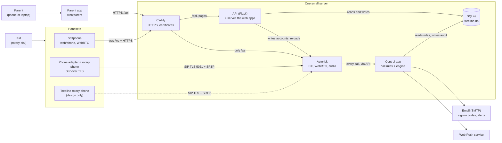
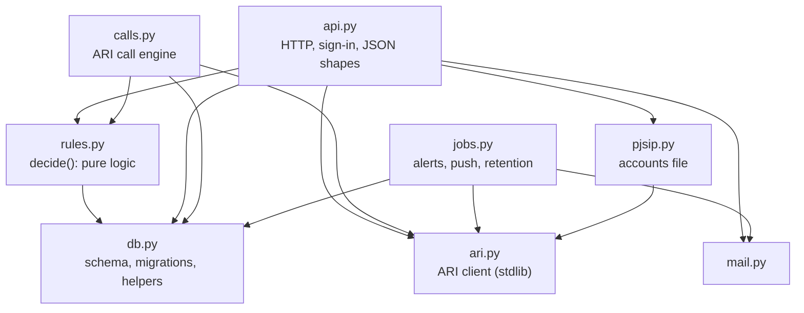
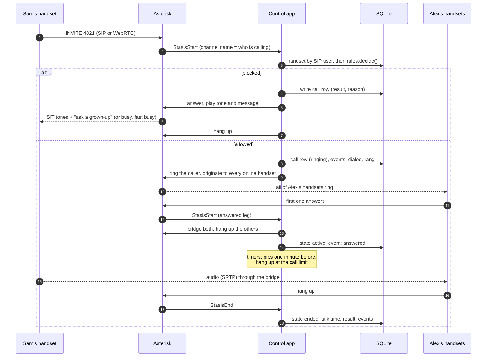
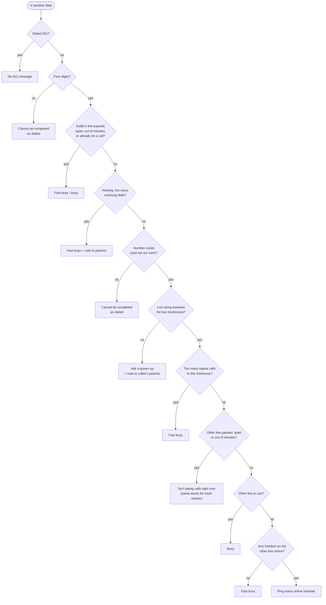
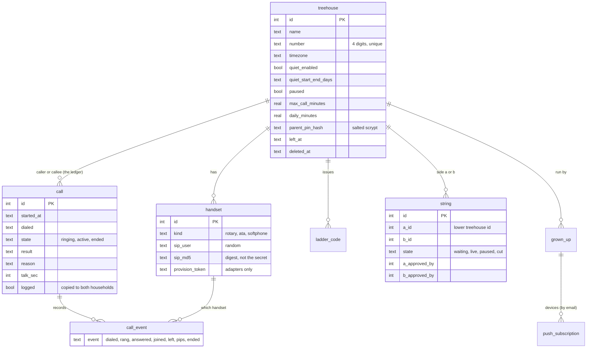
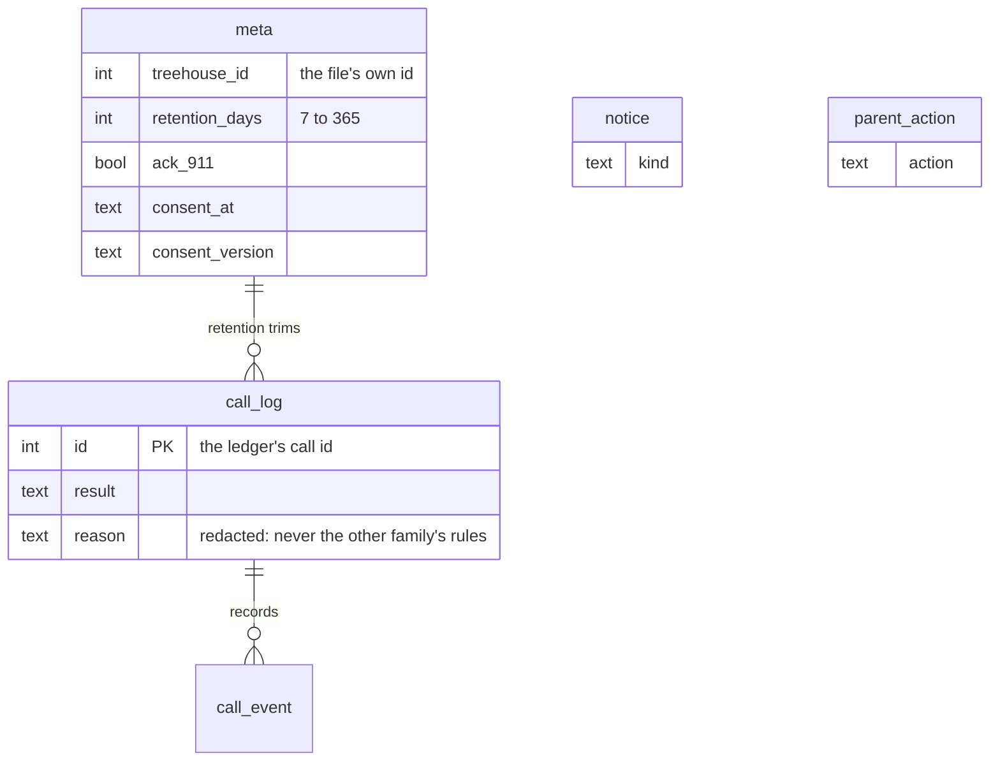
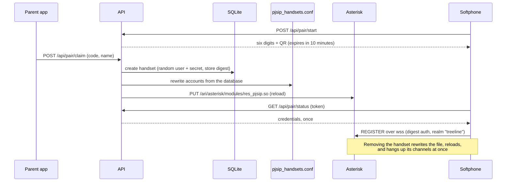
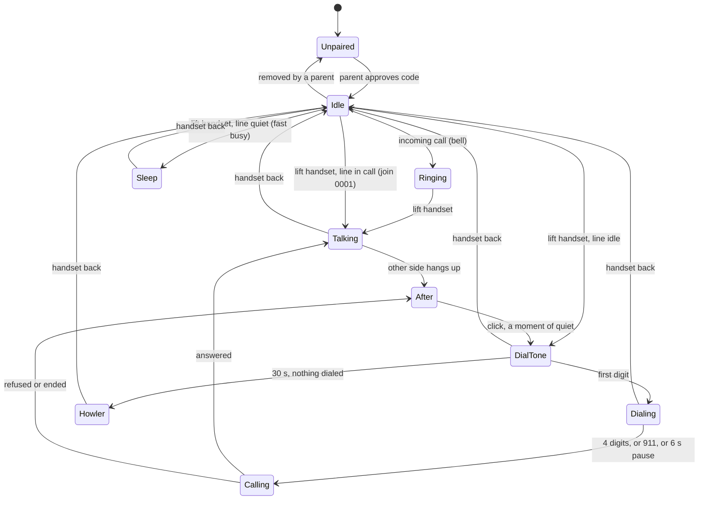
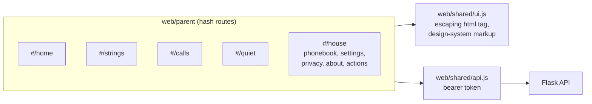
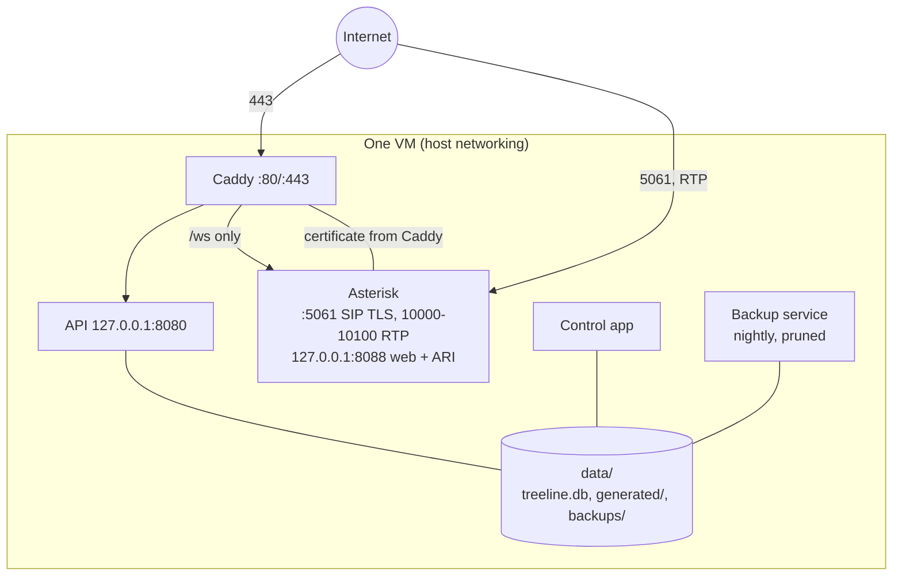

# Architecture

How Treeline fits together. For the product decisions and phases see [PLAN.md](PLAN.md); for running it see the [README](../README.md) and [DEPLOY.md](DEPLOY.md). The diagrams are [Mermaid](https://mermaid.js.org/) and render on GitHub and in most Markdown viewers.

## The idea in one paragraph

A household is a **treehouse** with one line, one 4-digit number, and any number of **handsets** (a softphone, a phone adapter with a rotary phone, or a Treeline rotary phone). Two treehouses can call each other only over a **string** that both families' parents approved. Asterisk carries the calls but never decides anything: every call is handed to a control app that applies the rules and writes an audit. Audio is never recorded.

## 1. System context

Two rules shape this picture. **Asterisk never routes on its own**: its only dialplan line sends every call to the control app. **Asterisk's REST interface (ARI) never leaves the machine**: in production it listens on `127.0.0.1` and Caddy forwards only `/ws` to it.

## 2. Components

| Component | Where | Does |
| --- | --- | --- |
| Asterisk | `asterisk/` | SIP and WebRTC endpoints, RTP/SRTP audio, tones from `indications.conf`, operator messages. No call logic |
| Control app | `controller/run_controller.py`, `treeline/calls.py`, `rules.py`, `jobs.py` | Listens to ARI events, decides every call, rings and bridges, times calls, writes the audit; background jobs for handset check-ins, alerts and retention |
| API | `treeline/api.py` | Everything the apps need (below); also serves the static web files with a Content-Security-Policy |
| Database | `treeline/db.py` | SQLite in WAL mode, shared by the control app and the API; numbered migrations |
| PJSIP generator | `treeline/pjsip.py` | Writes one account per handset into `/generated/pjsip_handsets.conf`, then asks Asterisk to reload |
| Parent app | `web/parent/` | Framework-free hash-routed app on the design system |
| Softphone | `web/phone/` | A Treeline page around the design kit's `RotaryPhone` (drawing, finger wheel, handset) and `CardFile`, Web Audio tones, calls over WebRTC with JsSIP |
| Shared web code | `web/shared/` | API client, formatting, and `ui.js`, which builds the design system's exact markup |
| Deployment | `deploy/` | Caddy, an Asterisk overlay with TLS and SRTP, backups, fail2ban |

### Layering in the Python code

`rules.py` is deliberately pure: it reads the database and returns a decision, with no Asterisk in it, so every rule is unit-tested without a phone. The call engine runs on the ARI websocket thread plus timer threads, so it uses a per-thread database connection (`db.local_conn()`).

## 3. A call, end to end

A handset's identity comes from the **channel name** (`PJSIP/<account>-<n>`), not the caller ID, so a handset can't pretend to be another one.

## 4. The rules

`rules.decide()` checks in this order and stops at the first match:

Every outcome is a row in the `call` table with a machine reason (for example `callee_quiet`). The callee's family sees only calls that had a live string, and never the caller's own rules; the caller sees a gentler, generic message so one family's schedule isn't revealed to another (`describe_call` and `visible_to_callee` in `api.py`).

**While a call is up**: it ends at the shorter of both treehouses' length limits (and any daily minutes left). Another handset on either line joins by dialing `0001`. The call lasts until every handset on one side has hung up.

## 5. Data model

That is the **central** database (`treeline.db`): what the app needs to route calls and to find a household from an outside key, plus the call **ledger** (calls in progress and the last three days, which the rules are computed from). Each treehouse also has its **own file**, `households/<id>.db`, with that family's call history (a redacted copy per call), notes for the parents, the log of what its grown-ups changed, and its consent and retention. Backing up, trimming or deleting one family never touches another's file. The rules for what lives where, the write order across the two kinds of file, and the schema-migration process are in [DATA_LAYER.md](DATA_LAYER.md).

Other central tables: `login_code` and `session` (email sign-in), `pairing` (tablet and device pairing codes), `setting` (knobs the tests change). Only the md5 digest of a handset's secret is stored for Asterisk; adapters, which fetch their settings by a private link, also keep the secret so that file can be made.

## 6. Handset accounts and registration

## 7. Softphone (browser)

The screen is an ordinary Treeline page built from the design system: the brand and tagline, the treehouse's name with a `Presence` for what the phone is doing, the `RotaryPhone` on a soft glow with the `CardFile` of live strings beside it, the phone's own "Can't call 911" notice under it, a "How to dial" sheet of picture steps, and the footer. The `RotaryPhone` reports the handset lifting, each dial pulse and each finished digit as events; the phone adds the logic around them, shows its line on the little light (steady green, pulsing orange while connecting, blinking red when it can't), and makes the handset tremble while it rings. `GET /api/line` also gives the page its words: the treehouse's name, its live strings and its quiet hours. The tablet makes its own dial tone, ringback, busy, bell, howler and click with Web Audio. On pickup it asks `GET /api/line` (HTTP Basic with its own account) what to do. The phone needs HTTPS for the microphone, except on `localhost`.

## 8. Parent app and API

| Area | Endpoints (all JSON, bearer token unless noted) |
| --- | --- |
| Sign-in | `POST /api/auth/request`, `/verify`, `/signout`; `GET /api/me` |
| Treehouse | `POST/PATCH/DELETE /api/treehouse`, `/number`, `/leave`; `GET /api/home` |
| Strings | `GET /api/strings`; `POST /api/ladder-codes`, `/api/strings/redeem`, `/<id>/approve`, `/pause`, `/resume`, `/cut` |
| Handsets | `GET/POST /api/handsets`, `PATCH/DELETE /<id>`, `/ring-test`, `/provision` |
| Pairing | `POST /api/pair/start`, `GET /status` (no sign-in); `POST /api/pair/claim`; `POST /api/factory/devices` (key) |
| Calls | `GET /api/calls`, `/calls/<id>`, `/calls.csv`, `/actions`, `/phonebook` |
| Notifications | `GET /api/push/key`; `POST/DELETE /api/push/subscribe` |
| Handset auth | `GET /api/line` (HTTP Basic with the handset's SIP account) |
| Ops | `GET /api/health` (503 if Asterisk is unreachable) |

Sign-in is an emailed six-digit code. Parents can change everything for their own treehouse; sitters can pause the line, turn quiet hours on or off, disconnect or ring a phone, and see today's calls (no action log, no other changes). Every change a grown-up makes is written to the action log.

## 9. Deployment

Development uses the same services with `docker-compose.yml` and a default ARI password, UDP SIP and sign-in codes shown on the page (to private addresses only). Never expose that stack to the internet. Optionally the web pages can sit on a static host (`scripts/build_static.py`) while only the API and Asterisk stay on the server.

## 10. Design decisions worth knowing

- **Calls are decided in one place.** Asterisk has a single dialplan line; every rule lives in `rules.py`. Adding a rule means adding a branch there and a scenario in `testphones/`.
- **Handset accounts are generated, not hand-written.** The database is the source of truth; Asterisk's config is derived and reloaded. Asterisk keeps only digests of secrets.
- **Tones are named in `indications.conf`.** ARI splits a `media` list on commas, so raw tone strings silently fail.
- **A call involves two families, so views are filtered.** What each side sees is computed per viewer. Each family has its own copy of a call, written redacted (a caller's copy never says why the callee wouldn't take the call), so retention trims one family's file without touching the other's.
- **Plain, framework-free web code.** The apps are ES modules on the design kit; markup goes through an escaping `html` tag, and button `attrs` built from data must be an object.
- **Real-call tests, not just row checks.** The tones, WebRTC sign-in and upgrade bugs were only found with real calls, real browsers and an upgraded database, so those paths have tests (`testphones/`, `web/tests/`, `controller/tests/test_db.py`, `test_households.py`).

## Not built

The pieces that need things this repository can't supply: a public server run and the pilot ([PILOT.md](PILOT.md)), a tried phone adapter ([ADAPTER.md](ADAPTER.md)), and the custom phone's firmware and board ([HARDWARE.md](HARDWARE.md)).
